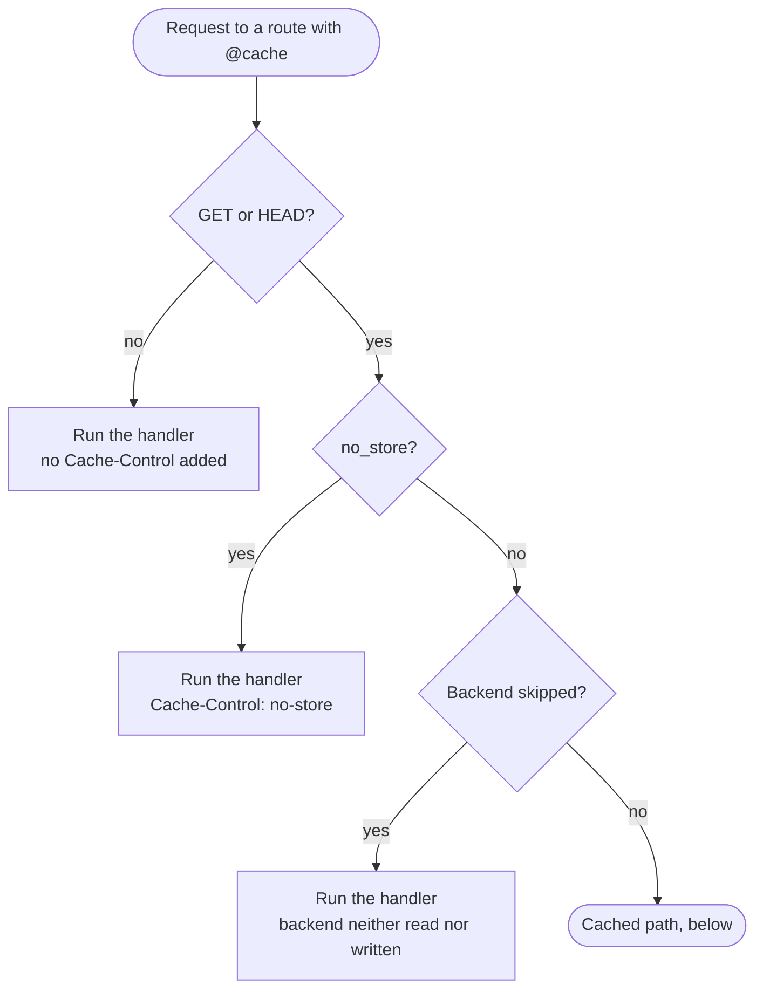
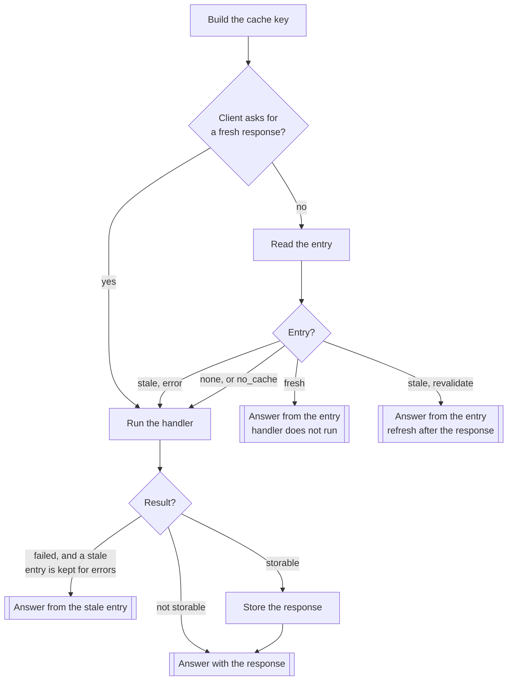

# FastAPI-CacheX Cache Flow

This document explains in detail how FastAPI-CacheX applies its caching logic to
HTTP requests. The decorator lives in
[`fastapi_cachex/cache.py`](https://github.com/allen0099/FastAPI-CacheX/blob/master/fastapi_cachex/cache.py), and the
parts it calls in private modules beside it:
[`_route.py`](https://github.com/allen0099/FastAPI-CacheX/blob/master/fastapi_cachex/_route.py) (how one request is
answered: the flow below),
[`_arguments.py`](https://github.com/allen0099/FastAPI-CacheX/blob/master/fastapi_cachex/_arguments.py) (argument
checks and warnings),
[`_params.py`](https://github.com/allen0099/FastAPI-CacheX/blob/master/fastapi_cachex/_params.py) (the wrapper's
signature),
[`_invalidation.py`](https://github.com/allen0099/FastAPI-CacheX/blob/master/fastapi_cachex/_invalidation.py)
(`invalidate()` and its relatives),
[`_key_builders.py`](https://github.com/allen0099/FastAPI-CacheX/blob/master/fastapi_cachex/_key_builders.py) (cache
keys), [`_vary.py`](https://github.com/allen0099/FastAPI-CacheX/blob/master/fastapi_cachex/_vary.py) (`vary=`),
[`_cache_control.py`](https://github.com/allen0099/FastAPI-CacheX/blob/master/fastapi_cachex/_cache_control.py)
(`Cache-Control`),
[`_stored_response.py`](https://github.com/allen0099/FastAPI-CacheX/blob/master/fastapi_cachex/_stored_response.py)
(storing and replaying a response, ETags and 304s),
[`_rendering.py`](https://github.com/allen0099/FastAPI-CacheX/blob/master/fastapi_cachex/_rendering.py) (running the
handler and adding its dependencies' headers) and
[`_coalesce.py`](https://github.com/allen0099/FastAPI-CacheX/blob/master/fastapi_cachex/_coalesce.py) (`coalesce=`).

## Overall flow

First, whether the backend is used at all:



Then, for a request on the cached path:



Every answer then gets its `Cache-Control`, `Vary` and, with
`debug_header=True`, `X-Cache`. Each step in more detail:

| Step | What happens |
|---|---|
| GET or HEAD? | Only GET and HEAD go through the cache, HEAD reading the entry of the GET. Every other method runs the handler directly and gets no `Cache-Control` header. |
| `no_store`? | The handler runs, the backend is neither read nor written, and the response says `Cache-Control: no-store`. |
| Backend skipped? | Yes for `private=True`, a route without a positive `ttl`, or a request with `Authorization` or session data on a route without `public` or `cache_authorized`; and for every route while caching is [switched off](TESTING.md#switching-off). The key builder does not run; `If-None-Match` is compared with the fresh response to decide between 304 and 200; with credentials, `Cache-Control` says `private` instead of `public`. With `cache_authorized` the backend is used, but every answer still says `private`. |
| Client asks for a fresh response? | Only on a route with `client_cache_control`. A request's `no-cache` or `max-age=0` skips the read: the handler runs and its response replaces the entry. A request's `no-store` is decided earlier and counts as "backend skipped". |
| Build the cache key | `key_builder` (default `http:v2\|method\|host\|path\|query`), plus one `name=value` component per `vary` header. |
| Read the entry | With `fail_open`, a backend error counts as a miss. So does an entry one of whose tags was invalidated since it was stored, and one stored before the route had its tags. With `coalesce=True`, a request that finds nothing waits for a request already rendering the same key, then reads again. With `coalesce="distributed"`, the request that leads in its process also takes a lock on the key, or waits for the worker that holds it. |
| Stale | Only with `serve_stale`, which keeps the entry for `ttl + stale_ttl`. `stale="revalidate"`: the entry answers at once (a 304 for a matching `If-None-Match`), and for a GET the handler runs after the response, as a background task of the request, to replace it. `stale="error"`: the handler runs, and the entry answers only if it raises or returns 5xx; an `HTTPException` below 500, or an exception the application handles, is the handler's answer and is sent as it is. |
| `no_cache` | The handler runs on every request; a matching `If-None-Match` gets a 304 after the fresh response is compared with it. |
| Answer from the entry | The stored status code, headers and body, plus `Age`. A request whose `If-None-Match` matches the entry's ETag gets a 304. |
| Result? | A failure, on a `stale="error"` route with a stale entry, is answered from that entry (see Stale). Otherwise the response is answered as it is, stored or not. Not stored: a non-2xx or 206 response (returned as it is, without the decorator's `Cache-Control`; an existing good entry is not overwritten), a streamed or file response (no ETag can be computed), a response with `Set-Cookie` or its own `private` / `no-store`, the response to a HEAD, and a response of a tagged route whose tag versions could not be read. Otherwise the response gets its ETag and is written, unless the entry already there has the same ETag and is not stale. With `fail_open`, a failed write is logged and the response is served unstored. |
| Answer with the response | If the client's `If-None-Match` matches the ETag of the fresh response (its entry expired, was cleared or evicted, was never stored, or is held by another worker), the answer is a 304 instead of the 200, carrying any `Set-Cookie` and the handler's background task. |
| Headers | `Cache-Control` from the decorator's arguments; a handler's own `private` / `no-store` is never replaced, and a response that sets a cookie gets `private` instead of `public`. With `vary`, the names are added to `Vary` on every GET or HEAD response. `X-Cache` with `debug_header=True`. |

## Detailed steps

### 1. Request interception and key generation

When a request arrives, the `@cache` decorator does the following:

```python
from fastapi_cachex import CacheKey
from fastapi_cachex.types import escape_key_component

# Cache key format (CacheKey in fastapi_cachex/cache_key.py;
# build_cache_key(request) is CacheKey.from_request(request).to_str())
cache_key = "|".join(
    [
        CacheKey.FORMAT_TAG,  # "http:v2"
        escape_key_component(request.method),
        escape_key_component(host),  # Host header, normalised (see below)
        escape_key_component(request.url.path),
        query,
    ]
)

# For example:
# http:v2|GET|example.com|/api/users|limit=10&page=1  (for ?page=1&limit=10)
# http:v2|GET|api.example.com|/api/users/123|
```

Every key starts with the format tag `http:v2`. Keys written in another format
(0.3.x wrote `GET|||host|||path|||query` with no tag) never collide with these,
and `clear_pattern("http:v2|*")` removes every key of this one on Redis and
memory. `CacheKey.parse()` only reads keys with this tag.

The separator is `|` rather than a colon because the host itself may contain a
port (`127.0.0.1:8000`); with a colon the key could not be split reliably, and
`clear_path()` needs to recover the path from the key.

The method, host and path are percent-encoded first: `|` becomes `%7C` and `%`
becomes `%25` (`escape_key_component` in `fastapi_cachex/types.py`). The host
and path come from the client, and a raw `|` in either would shift the
components so that one request's key could equal another's. The query string is
URL-encoded already, so it never contains `|`. The monitoring routes decode the
components again for display.

A custom `key_builder` can add components after the query string with
`build_cache_key(request, *components)`; they are encoded the same way, and
`clear_path()` still matches the path (see "Adding components to the key" in
[HTTP caching](HTTP_CACHING.md#adding-components-to-the-key)). `@cache(vary=[...])`
appends one `name=value` component per listed request header after whatever
the key builder returns, and adds the names to the response's `Vary` header
(see [Varying on request headers](HTTP_CACHING.md#varying-on-request-headers)).
For the credential headers `Authorization`, `Proxy-Authorization` and
`Cookie` a non-empty value is written as `sha256:<hex digest>`, so no token
appears in the key.

Query parameters are **sorted** by name (a stable sort: repeated values of one
name keep the order sent), so `?page=1&limit=10` and `?limit=10&page=1` share
one cache entry. `@cache(sort_query=False)` keeps the order the request sent
them instead (see [Cache keys](HTTP_CACHING.md#cache-keys)). A query longer
than 200 bytes is then replaced by `sha256:<hex digest>`, so the query part of
the key stays bounded.

The key format keeps each dimension cached independently:

- **Method isolation**: GET and POST do not share a cache (and only GET and HEAD
  enter the cache flow at all; HEAD uses the GET key and is never stored)
- **Host isolation**: `example.com` and `api.example.com` are cached separately;
  `Example.com` and `example.com:80` (on http) are `example.com`
- **Path isolation**: each endpoint has its own entries
- **Query parameter isolation**: different query parameters on the same endpoint
  are cached separately

### 2. Cache-Control directives

The decorator arguments control both the server-side behaviour and the
`Cache-Control` header sent to clients:

```python
# Change how the server-side cache is used
@cache(no_cache=True)     # Always re-run the handler (revalidate); entries are still written with a positive ttl
@cache(no_store=True)     # Never read or write the cache

# Normal caching behaviour
@cache(ttl=3600)          # Cache for 1 hour (also used as the max-age value)
@cache(ttl=3600, public=True)     # Allow shared caches, also for Authorization/session-data requests
@cache(private=True)      # Private only; never touches the shared backend
@cache(ttl=60, key_builder=per_user_key, cache_authorized=True)  # Authorization/session-data requests use the backend, answered private
@cache(ttl=3600, immutable=True)  # Content never changes

# Header-only directives (they do not change server-side behaviour)
@cache(ttl=60, must_revalidate=True)                        # must-revalidate
@cache(ttl=60, stale="revalidate", stale_ttl=30)            # stale-while-revalidate=30
@cache(ttl=60, stale="error", stale_ttl=300)                # stale-if-error=300

# Opt-in server-side behaviour
@cache(ttl=60, stale="revalidate", stale_ttl=30, serve_stale=True)  # serve the expired entry, refresh after the response
@cache(ttl=60, client_cache_control=True)   # honour a request's no-cache and no-store
@cache(ttl=60, tags=["users"])              # invalidated by invalidate_tags("users")
```

Arguments are validated when the decorator is applied, and a `CacheXError` is
raised if `public` and `private` are both set, if only one of `stale` /
`stale_ttl` is given, if `ttl` or `stale_ttl` is not an `int` or a `timedelta`
of whole seconds, is negative or is larger than `MAX_TTL`, if `vary` is not a
list of header field names, if `sort_query` is
not a `bool` or is passed with a custom `key_builder`, if `key_builder` is
an `async` callable, if `coalesce` is neither a `bool` nor `"distributed"`, or is set without a
positive `ttl` or together with `private` or `no_cache`, or if `debug_header`
is not a `bool`. So do `serve_stale` that is not a `bool`, is set without
`stale` or a positive `ttl`, or together with `private`, `no_cache` or
`must_revalidate`; `client_cache_control` that is neither a `bool` nor a plain
function; and `tags` that is a single `str`, holds something that is not a
non-empty `str`, or is an `async` function.

The header value is built once per decorated route:

| Arguments | `Cache-Control` sent |
|-----------|----------------------|
| `no_store=True` | `no-store` (overrides everything else) |
| `no_cache=True` | `no-cache`, plus `must-revalidate`, `proxy-revalidate` and `no-transform` if requested; `public`/`private`/`max-age`/`s-maxage`/`stale-*`/`immutable` are omitted |
| none (a bare `@cache()`) | none of its own; the handler's header, if any, is kept (`private` for a cookie or credentials, as on every route) |
| anything else | in order: `public` or `private`, `max-age=<ttl>`, `s-maxage=<n>`, `must-revalidate`, `proxy-revalidate`, `stale-while-revalidate=<n>` or `stale-if-error=<n>`, `immutable`, `no-transform` |

> [!NOTE]
> Without `ttl` (or with `ttl=0`, which sends `max-age=0`), the backend is
> neither read nor written: the handler runs on every request, and a matching
> `If-None-Match` is answered with `304` only after comparing it against the
> freshly rendered response. Set a positive `ttl` to have the server store and
> replay responses.

> [!WARNING]
> **The default cache key does not include the user's identity**, and the backend
> is shared by every worker and every user. Putting `@cache(ttl=...)` directly on
> an authenticated endpoint will serve user A's response to the next user B who
> requests the same path.
>
> For endpoints whose response depends on the caller, pick one:
>
> 1. `private=True` — never read from or write to the shared backend. It still
>    sends `Cache-Control: private` so the user's own browser can cache the
>    response, and `If-None-Match` is still compared against freshly rendered
>    content.
> 2. A custom `key_builder` that includes the identity, together with
>    `cache_authorized=True` — when you really do want a per-user server-side
>    cache. Without `cache_authorized`, a request with an `Authorization` header
>    or non-empty `request.session` data bypasses the backend (see below). With it, the answer is
>    still sent with `private`, since a shared cache downstream cannot see the
>    identity in the key.
>
> Take the identity from a trusted source (a verified token claim, a
> dependency-injected user object); do not trust unchecked client headers.

### 3. Cache lookup

The backend is queried with the cache key. It returns a `CacheEntry` (expired
entries are skipped by the backend itself):

```python
from fastapi_cachex.types import CacheEntry

entry = CacheEntry(
    fingerprint='W/"9f86d081..."',  # ETag, a weak validator for the content
    content=b'{"data": "response"}',  # raw response bytes
    media_type="application/json",
    status_code=200,  # replayed with the original status code
    headers=(
        ("link", "</a.css>; rel=preload"),
        ("link", "</b.js>; rel=preload"),
    ),  # header lines sent back on replay, in order
    stored_at=1702650540.5,  # epoch seconds when @cache stored it; drives Age
)
```

The TTL is not stored in `CacheEntry`: expiry is the backend's responsibility
(`MemoryBackend` keeps it in `CacheItem.expiry`, Redis uses `SET ... EX`,
Memcached uses the exptime). `stored_at` is wall-clock time (`time.time()`),
since the process that serves an entry may not be the one that stored it; it
is `None` for entries written by releases before 0.3.9.

If no backend has been configured with `BackendProxy.set()`, the decorator
creates a `MemoryBackend` on the first request, registers it and logs a
warning that the cache is per process.

**Decision logic** (`_Route.respond` in `_route.py`, in order):

```python
if request.method not in ("GET", "HEAD"):
    return await handler()  # no cache, no Cache-Control

if no_store:
    return await render()  # no read, no write

bypass = private or not ttl
# Authorization header, or non-empty request.session
credential = None if private or public else request_credential(request)
header = private_header if credential else decorator_header  # for every answer below
if bypass or (credential and not cache_authorized):
    response, etag = await render()  # backend neither read nor written
    return not_modified(...) if etag_matches(client_etag, etag) else response

# HEAD: key_builder sees the request with method GET
asked = client_asks(
    request
)  # client_cache_control only: "no-cache" (also for max-age=0), "no-store" or None
if asked == "no-store":
    ...  # as the bypass above: render, backend neither read nor written

cache_key = key_builder(request) + vary_components(request)  # built only here
# expired entries are already skipped here; an entry whose tags were invalidated since it was stored is skipped too
entry = None if asked == "no-cache" else await backend.get(cache_key)
if coalesce and entry is None and (leader := running_miss(cache_key)):
    await leader  # GET only leads; HEAD only waits
    entry = await backend.get(cache_key)  # None: render below, without waiting
elif coalesce == "distributed" and entry is None and not take_lock(cache_key):
    await lock_released(cache_key)  # another worker is rendering; HEAD only waits
    entry = await backend.get(cache_key)  # None: render below, without the lock

stale = (
    serve_stale and entry and age(entry) >= ttl
)  # serve_stale: kept for ttl + stale_ttl, stale once past ttl
if stale and stale_mode == "revalidate":
    background.add_task(
        refresh, cache_key
    )  # GET only; runs after the response, with the request's dependencies still open
    stale = False  # answered from the entry below, as X-Cache: STALE

if client_etag and no_cache:
    fresh = await render()  # no-cache: always re-render first
    if etag_matches(client_etag, fresh.etag):
        return not_modified(...)  # 304
elif (
    client_etag and entry and not stale and etag_matches(client_etag, entry.fingerprint)
):
    return not_modified(
        ..., age_headers(entry, stored_ttl)
    )  # 304, handler does not run

if entry and not no_cache and not stale:
    hit = Response(  # 200, handler does not run
        content=entry.content,
        status_code=entry.status_code,
        media_type=entry.media_type,
    )
    for name, value in entry.headers:  # every stored line, in order
        hit.headers.append(name, value)
    hit.headers["ETag"] = entry.fingerprint  # then ETag, Cache-Control and
    ...  # Age: now - stored_at, clamped to 0..stored_ttl (ttl, or ttl + stale_ttl)
    return hit

tags_before = await tag_versions(
    route_tags
)  # read before the handler runs; None if they cannot be read
# stale="error": if this raises or answers 5xx, the stale entry answers instead
response, body, etag = await render()  # miss (reused if no-cache already rendered)
if not is_cacheable_status(response.status_code):
    return response  # non-2xx: returned as-is, not written
if etag is None:
    return response  # streaming/file: no ETag, not written
shareable = not (
    marked_private_or_no_store(response)
    or "set-cookie" in response.headers
    or request.method == "HEAD"
)  # one caller's response, or a HEAD one, is not written
# also when the stored entry was stale; not when the tag versions are unknown
if (
    shareable
    and tags_before is not None
    and (not entry or entry.fingerprint != etag or stale)
):
    await backend.set(
        cache_key, CacheEntry(..., stored_at=time.time(), tags=...), ttl=stored_ttl
    )
if etag_matches(client_etag, etag):
    return not_modified(...)  # 304: the client's copy is still current;
    # it keeps the response's Set-Cookie lines and background task
return response
```

> [!NOTE]
> **`Age` on responses served from the backend.** A hit and a 304 answered from
> the stored ETag carry `Age: <seconds since stored_at>`, clamped to `0`–`ttl`
> (`0`–`ttl + stale_ttl` with `serve_stale`, where a stale answer carries an
> `Age` above `max-age`) against clock skew between hosts; `Cache-Control` keeps `max-age=<ttl>`, and
> a downstream cache subtracts `Age` from it (RFC 9111 §4.2.3). Responses the
> handler just rendered, including every `no_cache` response and every bypass,
> carry no `Age`, and neither do entries without `stored_at`.

> [!NOTE]
> "Non-2xx is not written" is deliberate: a transient error must not wipe out
> the last good cached response, nor be replayed later as a 200. `206 Partial
> Content` is not cached either, since its body only makes sense for the `Range`
> request that produced it. Non-2xx responses are also never answered with
> `304` and are returned without the decorator's `Cache-Control` header (only
> `no_store=True` adds `no-store` to every response).

> [!NOTE]
> **Responses that belong to one caller are never stored.** Following RFC 9111
> §3.5, a request with an `Authorization` header bypasses the backend (no read,
> no write), and so does one with a non-empty `request.session` (from any
> session middleware), unless the route is `public=True` or opts in with
> `cache_authorized=True` (for a `key_builder` that includes the verified
> identity). On a render, a response whose own `Cache-Control` contains
> `private` or `no-store` (whole directive, any case), or that sets a cookie,
> is served but not written. A `private`/`no-store` header from the handler is
> sent unchanged instead of the decorator's. A cookie response, and the answer
> to any `Authorization` or session-data request (bypassed or, with
> `cache_authorized`, served from the backend), are sent (200 or 304) with `private`
> in place of `public` and the decorator's other directives kept, except
> `s-maxage` and `proxy-revalidate` (`private,
> no-cache` on a `no_cache` route), so a downstream shared cache does not
> store them either. `must_revalidate=True` does not lift the `Authorization`
> bypass, although RFC 9111 would allow reuse under `must-revalidate`: the
> library requires the explicit opt-in. An entry already stored under the
> key is left alone, and a request that hits it before the handler runs is
> served from it as usual. Each skip is logged at `DEBUG`. Before 0.3.9 such
> responses were stored and replayed to every caller (#296); session
> requests were not bypassed until 0.3.9 either (#319).

### 4. ETag generation and validation

The ETag is computed from the response body and used to detect whether the
content has changed:

```python
# Generation: MD5, marked as a weak validator
def _etag_for(body: bytes) -> str:
    return f'W/"{hashlib.md5(body).hexdigest()}"'
```

`If-None-Match` is evaluated with **weak comparison** as specified by RFC 9110
§8.8.3.2, so:

```
If-None-Match: W/"abc"            → matches "abc" (the W/ prefix is ignored on both sides)
If-None-Match: "abc", W/"def"     → multiple values, compared one by one; any match → 304
If-None-Match: *                  → matches whenever the resource exists → 304
```

A 304 carries the same `Cache-Control` and `ETag` a 200 would, together with the
cache-steering headers `Vary`, `Content-Location` and `Expires`; otherwise an
intermediate cache would lose those fields after revalidation (RFC 9110
§15.4.5). A 304 for a response the handler just rendered also carries the
handler's `Set-Cookie` lines (such a response is always sent `private`).

## Backend storage formats

### MemoryBackend

```python
# dict[str, CacheItem]; CacheItem wraps the CacheEntry and records its expiry
{
    "http:v2|GET|example.com|/api/users|": CacheItem(
        value=CacheEntry(
            fingerprint='W/"abc123"',
            content=b"...",
            media_type="application/json",
            status_code=200,
            headers=(),
            stored_at=1702650540.5,
        ),
        expiry=1702650600.5,  # epoch seconds; None means never expires
    ),
}

# Characteristics:
# - Stored in process memory, not shared between processes
# - A background cleanup task sweeps expired items every cleanup_interval
#   seconds (default 60)
# - The cleanup task starts lazily on the first get/set/set_if_absent/increment/
#   get_and_delete call
# - get() deletes an expired item in place and reports a miss, without waiting
#   for the cleanup task
# - Keys are not prefixed
```

### Serialization shared by the network backends ([`backends/codec.py`](https://github.com/allen0099/FastAPI-CacheX/blob/master/fastapi_cachex/backends/codec.py))

Redis and Memcached share the same JSON codec; it uses `orjson` when installed
and the standard library `json` otherwise:

```json
{
  "fingerprint": "W/\"abc123\"",
  "content": "<response bytes decoded as latin-1>",
  "media_type": "application/json",
  "status_code": 200,
  "headers": [["vary", "Accept-Encoding"]],
  "stored_at": 1702650540.5
}
```

- `content` uses a **latin-1 round-trip**, not base64: latin-1 maps one-to-one
  onto bytes, so any byte sequence can be placed in JSON text and recovered
  unchanged.
- Entries written by older releases, without the `status_code`/`headers`
  fields, remain readable and decode to `200` with no extra headers. Those
  without `stored_at` (before 0.3.9) decode with `stored_at=None` and are
  served without an `Age` header.
- `headers` is a list of `[name, value]` lines, so a header sent more than once
  keeps every line. The object 0.3.x wrote (one value per name) still decodes.
  Anything else there makes the whole entry a miss.
- An entry stored with tags also has `"tags": {"users": "<version>"}`: the
  version each tag had when the entry was stored. An entry without tags is
  written exactly as before. If `tags` cannot be read the entry is a miss,
  never served as if it had none.
- Any decode failure (broken JSON, missing fields, wrong types) is treated as a
  **cache miss** and returns `None` instead of raising.
- `increment()` leaves a **bare integer** behind (written by the Redis/Memcached
  INCR family); it decodes to a `CacheEntry` whose fingerprint is `counter`.

### MemcachedBackend

```
key:   "fastapi_cachex:http:v2|GET|example.com|/api/users|"
value: the JSON document above

# Characteristics:
# - If the namespaced key contains whitespace, control characters or non-ASCII
#   bytes, or exceeds 250 bytes, it is stored under its SHA-256 hex digest
#   instead (`fastapi_cachex:<sha256>`); otherwise Memcached would reject it and
#   the request would fail with a 500
# - A TTL longer than 30 days is sent as an absolute epoch timestamp; otherwise
#   Memcached would read it as a moment in 1970 and expire the entry immediately
# - The protocol cannot enumerate keys, so clear_pattern()/get_all_keys()/
#   get_cache_data() are no-ops that return 0/[]/{} and emit a RuntimeWarning;
#   CacheManager.clear()/clear_prefix() therefore do nothing on this backend
# - clear_path() only deletes a key exactly equal to the given path, so it
#   cannot clear HTTP route entries, and it emits a RuntimeWarning on every
#   call; use invalidate(request) to drop a cached route's entry
# - clear() issues flush_all, which wipes the ENTIRE Memcached server (not just
#   this key prefix) and emits a RuntimeWarning
# - The synchronous pymemcache client runs in worker threads, with connection
#   pooling and default_noreply=False
```

### AsyncRedisCacheBackend

```
key:   "fastapi_cachex:http:v2|GET|example.com|/api/users|"
value: the JSON document above

# Characteristics:
# - Expiry is set with SET ... EX <ttl> (plain SET when ttl is None)
# - Pattern operations page through keys with SCAN (COUNT=100) instead of KEYS,
#   so the server is never blocked
# - clear() only removes keys under this backend's key prefix
# - get_and_delete() uses GETDEL (requires Redis 6.2+); deletions are sent as
#   batched DELs of up to 100 keys
# - increment() runs a registered Lua script, so incrementing and setting the TTL
#   are one atomic operation
```

> [!NOTE]
> The `/cached-hits` and `/cached-records` routes mounted by `add_routes()` read
> expiry from `get_cache_data()`. The memory backend tracks it directly and
> Redis reports each key's `PTTL`; on Memcached, which cannot enumerate keys,
> these endpoints return no entries at all.

## Cache clearing strategies

### Automatic clearing

```python
# MemoryBackend: sweeps every cleanup_interval seconds (default 60)
async def cleanup_task():
    while True:
        await asyncio.sleep(self.cleanup_interval)
        # remove every item whose CacheItem.expiry has passed


# The task is only started lazily on the first get/set/set_if_absent/increment/
# get_and_delete call (it needs a running event loop), so write-only usage (for
# example CacheManager.add()) starts it too.

# Redis/Memcached: TTL mechanism
# Use the backend's built-in TTL (SET ... EX, exptime)
# Items expire on their own; no cleanup task is needed
```

### Manual clearing

`clear_path()`, `clear_pattern()`, `clear()` and `invalidate()` are covered in
[HTTP caching](HTTP_CACHING.md#clearing-the-cache).

## Performance

On a cache hit the route function does not run: the cost is one backend
lookup, plus the route's dependencies, which FastAPI resolves before the
`@cache` wrapper is called and which therefore run on every request (see
[What still runs on a hit](HTTP_CACHING.md#what-still-runs-on-a-hit)).
Which backend to pick is covered in [Backends](BACKENDS.md#choosing-a-backend).

## Cache invalidation scenarios

| Scenario | Behaviour |
|----------|-----------|
| `no_store=True` | The cache is neither read nor written; the endpoint runs every time |
| `no_cache=True` | The endpoint runs every time to recompute the ETag; a match with the client's `If-None-Match` still returns 304, and the cache is updated when the ETag changes |
| `private=True` | The **shared backend** is neither read nor written; `Cache-Control: private` is still sent and the ETag is compared against fresh content |
| Request with `Authorization` or non-empty `request.session` | The backend is neither read nor written, as with `private=True`, and `Cache-Control` has `private` instead of `public`, unless the route has `public=True` or `cache_authorized=True` (`must_revalidate=True` is not enough); with `cache_authorized=True` the backend is used but `Cache-Control` still has `private` |
| Handler sends `Cache-Control: private`/`no-store` | Returned with the handler's header intact, not written, and any existing entry is left untouched |
| Response sets a cookie | Returned with `private` instead of `public` in `Cache-Control`, not written, and any existing entry is left untouched |
| No `ttl` (or `ttl=0`) | The backend is neither read nor written, as with `private=True`; the endpoint runs every time and the ETag is compared against fresh content |
| Cache expired (TTL elapsed) | The endpoint runs again; `MemoryBackend` deletes the expired entry in place when it reads it |
| Non-2xx or 206 response | Returned as-is, not written, and any existing entry is left untouched |
| Streaming/file response | No ETag can be computed; returned as-is and not written |
| Manual `invalidate()` call | The key for that route is deleted |
| Manual `clear_path()` / `clear_pattern()` / `clear()` call | Cleared according to scope (on Memcached, `clear_path()` only deletes an exact key, `clear_pattern()` is a no-op, and `clear()` flushes the whole server) |

## Implementation details

### Cache entry structure

The actual types are dataclasses defined in
[`fastapi_cachex/types.py`](https://github.com/allen0099/FastAPI-CacheX/blob/master/fastapi_cachex/types.py):

```python
@dataclass
class CacheEntry:
    fingerprint: str  # ETag, formatted as W/"<md5>"
    content: bytes  # raw response bytes
    media_type: str | None = None
    status_code: int = 200  # replayed as-is
    headers: tuple[tuple[str, str], ...] = ()  # (name, value) lines sent back on replay
    stored_at: float | None = None  # epoch seconds when @cache stored it; drives Age


@dataclass
class CacheItem:
    value: CacheEntry
    expiry: float | None = None  # epoch seconds; used by MemoryBackend only
```

`headers` stores the headers the handler set itself, excluding fields that must
be recomputed for every response or must not be replayed: `Set-Cookie`,
`Content-Length`, `Transfer-Encoding`, `Connection`, `Date`, `ETag`,
`Cache-Control`, `Content-Type` and `Age` (`Content-Type` is restored from
`media_type`; storing both would emit the header twice).

Counters (`backend.increment()`) are also represented as a `CacheEntry`: the
fingerprint is always `counter` and `content` is the decimal value as bytes, so
deletion, clearing and monitoring all treat them the same way.

### Request flow code example

See the decision logic in "3. Cache lookup" above for the decorator's internal
order; on the user side all you need is:

```python
@app.get("/expensive")
@cache(ttl=3600)
async def expensive_endpoint():
    # This function only runs on a cache miss (or when revalidation is needed)
    return await perform_calculation()
```

The handler does not have to declare a `Request` itself: `@cache` injects a
keyword-only parameter named `__cachex_request` into the signature (placed
before `**kwargs` if the handler has one). If the handler **already** declares a
`Request` (including a string annotation, `Annotated[...]`, or a `Request`
subclass), that parameter is reused and nothing is injected.

## FAQ

**Q: Why doesn't a cache hit always return 200?**
A: It depends. If the request carries an `If-None-Match` header whose ETag
matches, a 304 is returned to save bandwidth. Without the header, a 200 with the
content is returned.

**Q: Why aren't POST/PUT responses cached?**
A: `@cache` only applies to GET (and HEAD, answered from the GET entry). Every
other method runs the handler directly, without reading or writing the cache
and without adding a `Cache-Control` header.

**Q: Why are there several cache entries for the same endpoint?**
A: Because the cache key includes the query parameters. `/users?page=1` and
`/users?page=2` are different entries, and so are `?a=1&b=2` and `?b=2&a=1` if
the route sets `sort_query=False`.

**Q: How does MemoryBackend work across multiple processes?**
A: It doesn't. Each process has its own cache; use Redis in production.

**Q: Is clearing the cache synchronous or asynchronous?**
A: Asynchronous: `await cache.clear_path(...)` or `await
cache.clear_pattern(...)`. Note that `clear_pattern()` (as well as
`get_all_keys()` and `CacheManager.clear()`) is a no-op on the Memcached
backend, because the Memcached protocol cannot enumerate keys.
